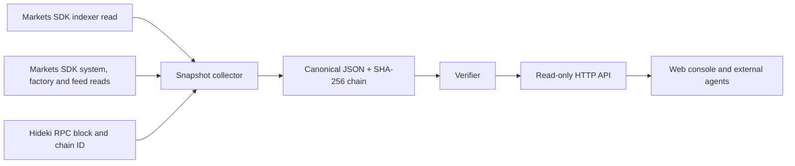

# Architecture

The collector checks RPC chain ID before reading the SDK. It does not receive a signer. Indexer rows and feed reads have distinct sources and timing. The block reference identifies the sampled RPC head; it does not imply an atomic multi-source snapshot. The SHA-256 chain detects mutation and broken adjacency when the original head is retained. Publishing the head hash in a Git commit or other external record strengthens independent verification.

Future execution work will require a separate wallet, a durable idempotency ledger, explicit transaction caps, receipt decoding and before/after account reads. No transaction path exists in this revision.
