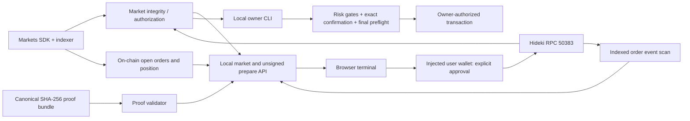

# Architecture

`src/server.ts` binds to localhost and serves the home terminal from `web/index.html`, `web/terminal.js`, `web/trading.js`, and `web/terminal.css`. The historical research interface remains at `/legacy`. The terminal GET routes expose sanitized proof, market, history and owner plan data. M5 `/api/v1/trade/account`, `/prepare`, and `/receipt` read an EOA and build an unsigned direct order; the server has no user private keys and never broadcasts.

`src/terminal-data.ts` validates the first proof bundle's canonical hash, plan and receipt identity, and matching `OrderPlaced` / `OrderRested` logs. The history reader checks chain ID, queries the BTC-PERP pool with the exact indexed order ID for terminal events and both maker/taker fill positions, and reads current open orders and position through the SDK. It scans 1000-block RPC windows and caches completed windows in memory for incremental refresh. Each response states the last scanned and position-read block. A missing terminal event remains `UNKNOWN`, even when the order is absent from the open list.

The market reader reuses `inspectTradingAuthorization` and its `validateMarketSnapshot` result, which compares pinned SDK and direct HTTPS book tops, block hashes, timestamps, tick grid, and mark sanity. It then reads up to five contract `getBookLevels` per side at the same block and displays depth only when both top levels match the trusted quote. The browser appends only actual mark observations made since page open to its in-memory line chart. It does not infer historical candles or volume.

The browser's injected wallet can be asked to send an order only after Canary Trade Guard review, a second fresh preflight, and explicit user confirmation. This EOA path has no real on-chain placement proof yet. The separate owner CLI persists a hash-bound plan, enforces the existing M4.1.5 limits, and repeats full preflight after exact confirmation. Proof generation compares the mined transaction and receipt against that plan. Earlier M0–M3 research and evidence paths remain in the repository.
