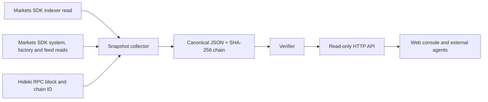

# Architecture

The collector checks RPC chain ID before reading the SDK. It does not receive a signer. Indexer rows and feed reads have distinct sources and timing. The block reference identifies the sampled RPC head; it does not imply an atomic multi-source snapshot. The SHA-256 chain detects mutation and broken adjacency when the original head is retained. Publishing the head hash in a Git commit or other external record strengthens independent verification.

The M1 layer adds a read-only SDK preflight and a separate local evidence chain for plans and imported receipts. Receipt decoding uses the SDK's published event ABIs. M2 adds a browser-only EIP-1193 wallet controller. The server builds an unsigned perp order with the SDK and cannot submit it. A fresh preflight and explicit browser decision precede the wallet's own confirmation. The browser does not automatically retry a send with an unknown outcome.
